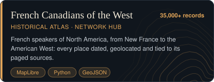
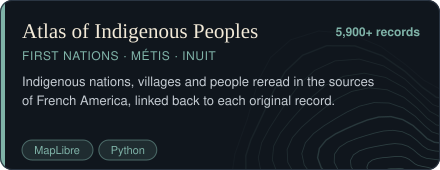
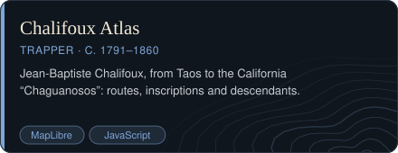
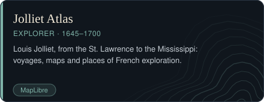
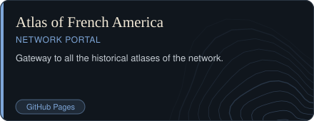
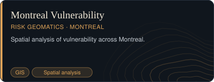

<a href="https://github.com/geolas2023">🇫🇷 Français</a> · <b>🇬🇧 English</b>

  

  

  
  
  
  
  

---

### 👋 Hello!

I am **Olivier J. Caron**, professor in the Department of Geography at **UQAM** (Université du Québec à Montréal) and research affiliate at the **Illinois State Geological Survey**. Trained as a Quaternary geologist, I design geomatics analysis models and geospatial data dissemination tools, from 3D mapping of Chicago's glacial deposits to permafrost in the Yukon.

Since 2026, I have also been building a **network of historical atlases of French America**: interactive maps where every place is dated, geolocated with its degree of certainty and tied to its sources (books, parish registers, censuses, newspapers).

- 🗺️ **Currently:** working through sources on French speakers in the Mississippi Valley and the American West
- 🧊 **Research:** Quaternary geology, 3D modelling, hydrogeology, risk geomatics
- 🎓 **Teaching:** GIS, geographic data structures, visualization, emergency geomatics
- 🌐 **Languages:** French · English

---

## 🧭 The French America atlas network

  
  

  
  

  
  

  
  

Click a card to open the live atlas (in French). Source code is in the repository of the same name.

## 🏙️ Geomatics and environment — Montreal

  
  

  

## 🛠️ Tools

           

## 📈 Activity

  

  

<picture>
  <source media="(prefers-color-scheme: dark)" srcset="https://raw.githubusercontent.com/geolas2023/geolas2023/output/serpent-sombre.svg">
  <source media="(prefers-color-scheme: light)" srcset="https://raw.githubusercontent.com/geolas2023/geolas2023/output/serpent.svg">
  
</picture>

---

Department of Geography, Université du Québec à Montréal · Montreal, Quebec

