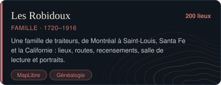
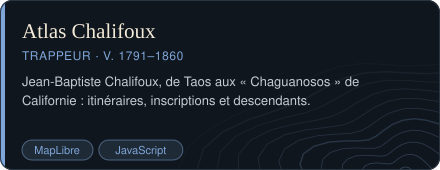
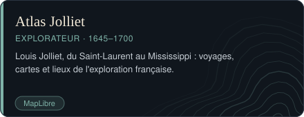
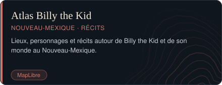
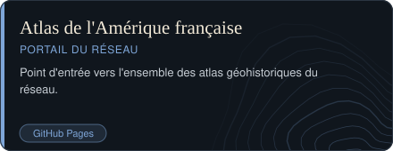
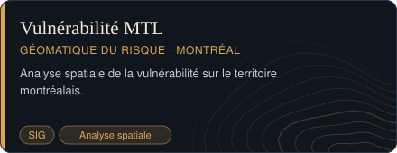
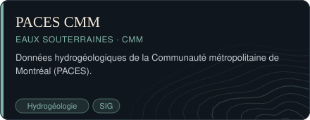
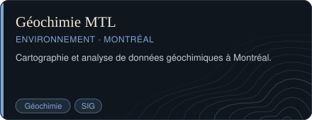

<b>🇫🇷 Français</b> · <a href="https://github.com/geolas2023/geolas2023/blob/main/README.en.md">🇬🇧 English</a>

  

  

  
  
  
  
  

---

### 👋 Bonjour !

Je suis **Olivier J. Caron**, professeur au Département de géographie de l'**UQAM** et chercheur associé à l'**Illinois State Geological Survey**. Géologue du Quaternaire de formation, je conçois des modèles d'analyse géomatique et des outils de diffusion des données géospatiales, de la cartographie 3D des dépôts glaciaires de Chicago au pergélisol du Yukon.

Depuis 2026, je construis aussi un **réseau d'atlas géohistoriques de l'Amérique française** : des cartes interactives où chaque lieu est daté, géolocalisé avec son degré de certitude et rattaché à ses sources (livres, registres, recensements, journaux).

- 🗺️ **En ce moment :** le dépouillement des sources sur les francophones de la vallée du Mississippi et de l'Ouest américain
- 🧊 **Recherche :** géologie du Quaternaire, modélisation 3D, hydrogéologie, géomatique du risque
- 🎓 **Enseignement :** SIG, structures de données géographiques, visualisation, géomatique de l'urgence
- 🌐 **Langues :** français · English

---

## 🧭 Le réseau des atlas de l'Amérique française

  
  

  
  

  
  

  
  

Cliquer sur une carte ouvre l'atlas en ligne. Le code source est dans le dépôt du même nom.

## 🏙️ Géomatique et environnement — Montréal

  
  

  

## 🛠️ Outils

           

## 📈 Activité

  

  

<picture>
  <source media="(prefers-color-scheme: dark)" srcset="https://raw.githubusercontent.com/geolas2023/geolas2023/output/serpent-sombre.svg">
  <source media="(prefers-color-scheme: light)" srcset="https://raw.githubusercontent.com/geolas2023/geolas2023/output/serpent.svg">
  
</picture>

---

Département de géographie, Université du Québec à Montréal · Montréal, Québec

